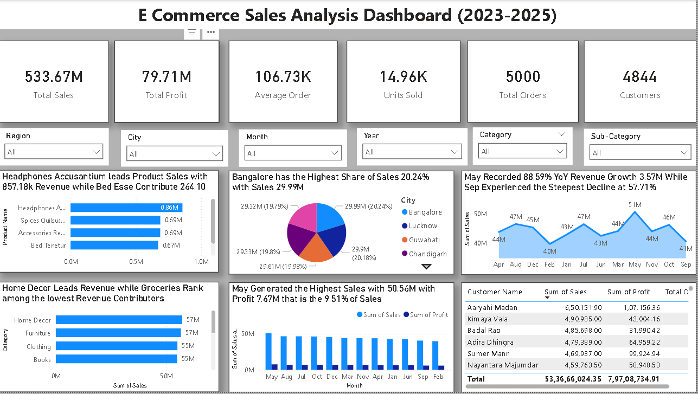

# 📊 E-Commerce Sales Analysis Using SQL

# 📊 Super-Store-Sales-Dashboard-SQL-Excel-Power-BI
<p align="center">
  
</p>

<p align="center">


</p>


## 📌 Project Overview

This project demonstrates an end-to-end SQL-based analysis of an e-commerce sales dataset using PostgreSQL.

The objective is to transform raw transactional data into meaningful business insights by applying data cleaning, feature engineering, KPI analysis, customer segmentation, product analysis, and advanced SQL techniques.

---
## 🚀 Features

- End-to-End SQL Analysis
- Data Cleaning & Validation
- Feature Engineering
- KPI Analysis
- Customer Segmentation (RFM)
- Time Series Analysis
- Window Functions
- Pareto Analysis
- Business Insights
- Business Recommendations
  
## 🎯 Business Objectives

- Analyze overall sales performance
- Identify high-performing products and categories
- Evaluate customer purchasing behavior
- Measure regional sales performance
- Analyze discount effectiveness
- Discover profit improvement opportunities
- Generate actionable business recommendations

---

# 🛠 Tools & Technologies

- PostgreSQL
- SQL
- Window Functions
- Common Table Expressions (CTEs)
- Aggregate Functions
- CASE WHEN
- Date Functions

---

# 📂 Dataset

The dataset contains e-commerce transaction records including:

- Orders
- Customers
- Products
- Categories
- Regions
- Payment Methods
- Discounts
- Sales
- Profit
- Order Dates

---

# 🧹 Data Cleaning

- Removed duplicate records
- Checked NULL values
- Validated data types
- Standardized text values
- Created enriched helper columns
- Generated Quarter column
- Created Profit Margin
- Created Discount Bucket
- Created Order Size Category
- Created High Value Order Flag

---

# 📊 SQL Concepts Used

- SELECT
- WHERE
- GROUP BY
- HAVING
- ORDER BY
- CASE WHEN
- Aggregate Functions
- JOINS
- CTEs
- Window Functions
- ROW_NUMBER()
- RANK()
- DENSE_RANK()
- LAG()
- Running Total
- Market Share Analysis
- RFM Analysis
- Pareto Analysis

---

# 📈 Analysis Performed

- KPI Analysis
- Category Analysis
- Product Analysis
- Customer Analysis
- Geographic Analysis
- Payment Method Analysis
- Discount Analysis
- Quarterly Analysis
- Time Series Analysis
- Customer Segmentation
- Profitability Analysis
- Statistical Analysis

# /*
FINAL BUSINESS CONCLUSION:

The analysis identified five major business opportunities:

1. REVENUE RECOVERY:
   Revenue declined by ₹5.58M, with order volume
   decreasing by 12.04% and AOV decreasing by 6.50%.

2. CATEGORY PERFORMANCE:
   Home Decor revenue declined by ₹11.13M (-35.63%).
   Lamp accounted for 46.95% of the identified
   overall revenue decline.

3. PROFITABILITY:
   Vase recorded a profit decline of ₹192,494.73.
   Several products operated at approximately
   5% profit margins.

4. DISCOUNT OPTIMIZATION:
   The 20% discount tier showed a 14.74% margin
   compared with 15.22% at the 5% tier.

5. CUSTOMER RETENTION:
   4,690 customers made only one purchase, while
   1,444 high-value customers were classified as
   inactive under the 180-day definition.

OVERALL RECOMMENDATION:

The business should focus on profitable growth rather
than revenue expansion alone.

Priority actions:
- Recover declining sales in Home Decor and Lamp.
- Investigate product-level profitability.
- Optimize discounts using incremental profit.
- Improve customer repeat-purchase rates.
- Reactivate valuable inactive customers.

The objective is to increase revenue while protecting
profit margins and strengthening customer retention.
*/

---

# 📁 Repository Structure

```
E-Commerce-Sales-Analysis-SQL
│
├── Raw_E_Commerce_Sales_Data.csv
├── E_Commerce_Business_Analysis.sql
├── README.md
```

---

## 💼 Skills Demonstrated

- SQL
- PostgreSQL
- Data Cleaning
- Data Validation
- Feature Engineering
- Data Analysis
- Window Functions
- Common Table Expressions (CTEs)
- Time Series Analysis
- Customer Analytics
- Business Intelligence

# 👨‍💻 Author

**Jatin Patidar**

- LinkedIn: https://www.linkedin.com/in/jatinpatidar09/
- GitHub: https://github.com/09jatin
- Email jatinpatidar606@gmail.com

---

## ⭐ Support

If you found this project useful, consider giving it a ⭐ on GitHub.

Thank you for visiting this repository!

